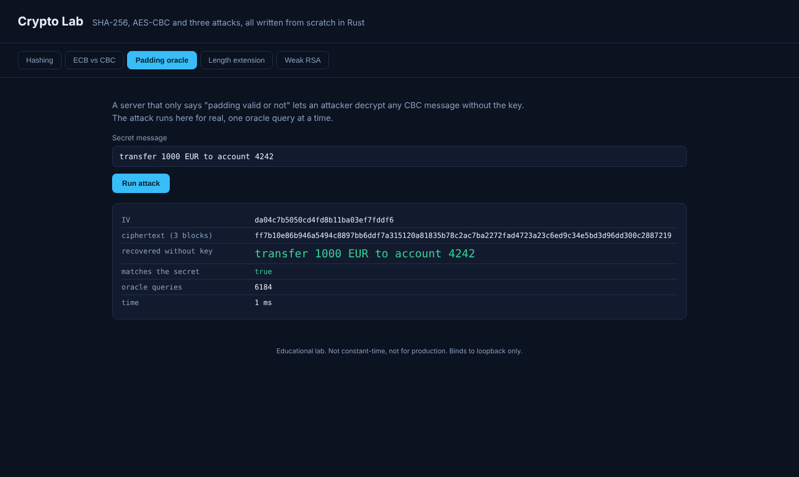
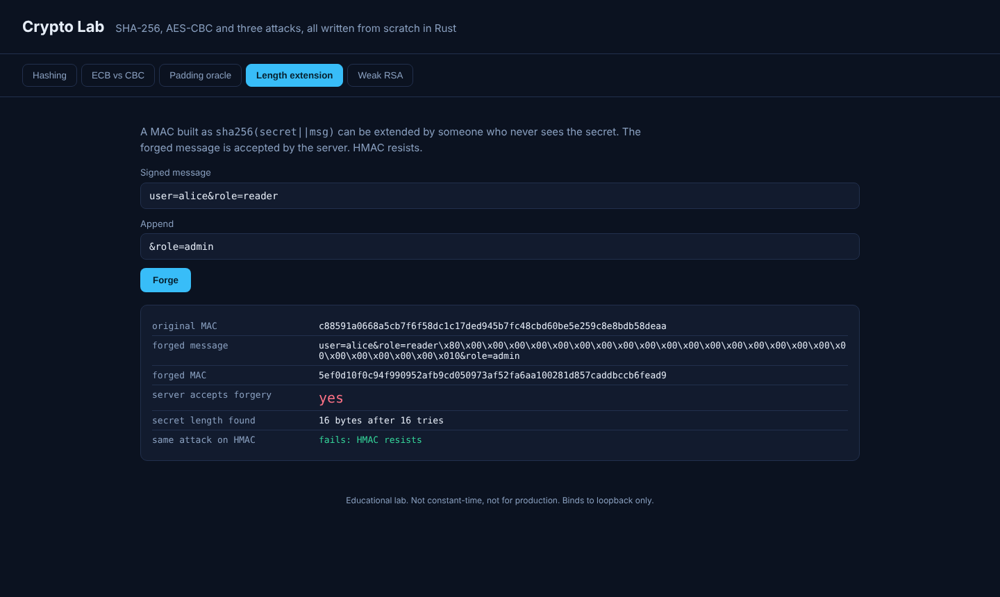
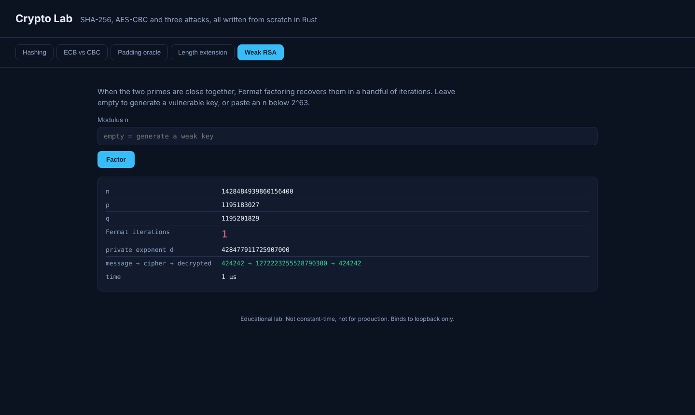

# Crypto Lab

[](https://github.com/jvch0512/crypto-lab/actions/workflows/ci.yml)

A hands-on cryptography lab in Rust with **zero dependencies**. SHA-256, HMAC, AES-128 and CBC are implemented from scratch and verified against official test vectors, then used to run three real attacks against deliberately flawed constructions, with a web UI to watch each one work.



> Built with AI assistance (Claude). Educational code: not constant-time and not for production use.

## Run

```bash
cargo run --release
# http://127.0.0.1:8100
```

## What is inside

| Tab | What it shows | Reference |
|---|---|---|
| Hashing | SHA-256 and HMAC, avalanche effect (bits flipped by changing one input bit) | FIPS 180-4, RFC 4231 |
| ECB vs CBC | Equal plaintext blocks give equal ECB ciphertext, CBC hides the pattern | NIST SP 800-38A |
| Padding oracle | Decrypts CBC ciphertext **without the key**, using only "is the padding valid?" answers (about 6,900 queries for a 34-byte message) | Vaudenay 2002 |
| Length extension | Forges a valid MAC for `msg + padding + extra` against `sha256(secret ‖ msg)` without knowing the secret, even its length. The same attack fails against HMAC | Duong and Rizzo, Flickr API 2009 |
| Weak RSA | Fermat factoring recovers close primes in a few iterations, derives the private key and decrypts | Fermat 1643, real-world cases of poor key generation |

| Dashboard views | |
|---|---|
|  |  |

## Correctness

Implementations are checked against published vectors:

- SHA-256: empty string, `abc`, the 448-bit NIST message and the one-million-`a` vector, plus incremental hashing across every block boundary
- HMAC-SHA-256: RFC 4231 cases including a key longer than the block size
- AES-128: FIPS 197 appendices B and C (encrypt and decrypt) and SP 800-38A CBC
- The S-box is derived at runtime from GF(2^8) inversion instead of being typed in, which removes a whole class of typo bugs

The padding oracle also handles the classic `02 02` false positive on the last byte, and has a test for it.

## Design notes

- `src/sha256.rs` exposes `from_digest`, resuming the compression function from a known digest. That single capability is what makes length extension possible, and it is also why the attack is a few lines of code.
- `src/api.rs` is pure `(path, query) -> (status, json)`, so every endpoint is unit-tested without sockets. `src/http.rs` is a small HTTP/1.1 server on `std` with header size caps, timeouts, a connection cap and strict CSP.
- Input limits: 480 bytes of text per request, RSA moduli below 2^63, 5 million Fermat iterations.
- Binds to loopback only and refuses anything else.

## Tests

```bash
cargo test            # 32 tests
cargo clippy --all-targets -- -D warnings
```

## License

MIT
